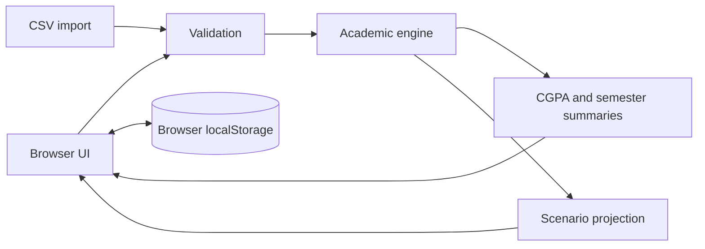

# GradeLens UAF

[](https://github.com/zasclan/gradelens-uaf/actions/workflows/ci.yml)
[](https://zasclan.github.io/gradelens-uaf/)

A privacy-first academic result analyzer for University of Agriculture Faisalabad students. GradeLens calculates CGPA directly from transcript credit hours and quality points, compares clearly labelled repeat-course scenarios, and models future performance without transmitting student records to a server.

> Independent student project. It is not affiliated with or endorsed by the University of Agriculture Faisalabad.

## Why this project exists

Academic calculators often hide their assumptions or ask students to expose identifiers to a third-party service. GradeLens takes a different approach:

- **Local-only data:** records remain in browser storage.
- **Auditable calculation:** `CGPA = total quality points / total credit hours`.
- **No grade inference:** it does not guess quality points from marks.
- **Explicit scenarios:** repeat-course rules are comparisons, not claims about university policy.
- **Portable records:** CSV import and export use a documented schema.

## Features

- Manual transcript entry with defensive validation
- Exact cumulative and semester GPA calculation
- All-attempt, latest-attempt and best-attempt comparisons
- Future-CGPA scenario planner
- Semester performance visualization
- CSV import/export, including quoted values
- Local persistence with one-action deletion
- Responsive, accessible interface
- Dependency-free calculation engine with automated tests

## Architecture



The academic engine is a pure JavaScript module. UI state and persistence stay at the boundary, which makes the calculation logic easy to test and reuse.

## CSV schema

```csv
semester,code,title,creditHours,qualityPoints,attempt
"Semester 1","CS-101","Programming Fundamentals",3,9.33,1
```

## Run locally

Serve the repository with any static server, for example:

```bash
npx serve .
```

Then open the printed local URL.

## Verify

```bash
npm test
npm run check
```

The tests cover exact aggregation, repeat selection, projections, invalid values and quoted CSV parsing.

## Privacy and limitations

- GradeLens never contacts a student portal and never requests a registration number.
- Browser storage is accessible to anyone using the same browser profile; clear it on a shared computer.
- Repeat-course choices are planning scenarios. Students should use their official transcript and university regulations for formal decisions.
- The tool does not generate an official transcript or replace university records.

## Author

**Muhammad Arbab Ahmed** — Computer Science graduate interested in dependable web, cloud and networked systems.
